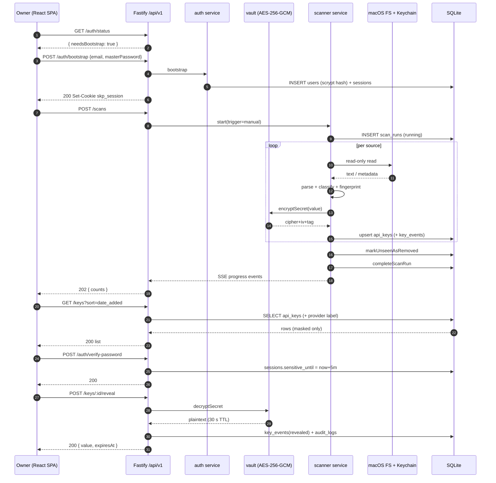
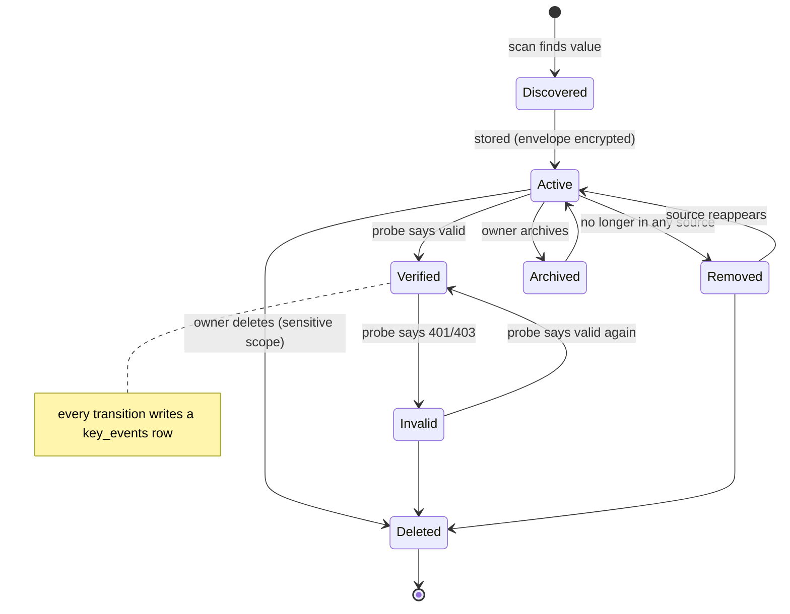
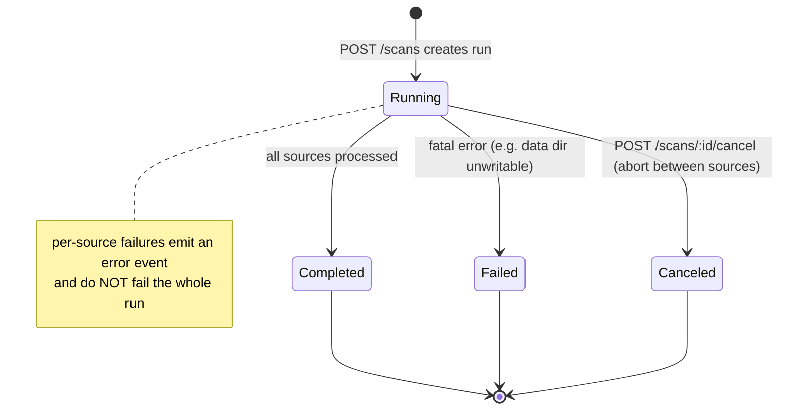
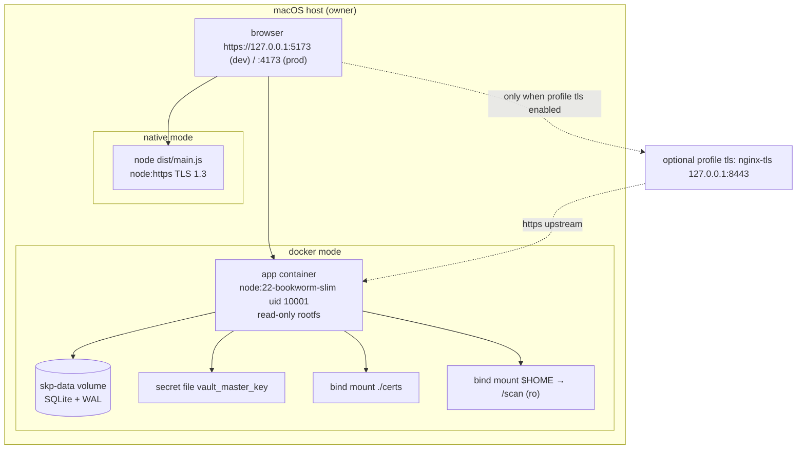

# Diagrams — SecretKeyPreview

All diagrams render with Mermaid.js.

## 1. End-to-end sequence (bootstrap → scan → reveal)



## 2. Component / class hierarchy

```mermaid
flowchart TD
    subgraph web["packages/web (React 19 + Vite)"]
        App[App.tsx] --> Shell[components/AppShell.tsx]
        App --> Login[features/LoginPage.tsx]
        App --> Dash[features/DashboardPage.tsx]
        App --> Detail[features/KeyDetailPage.tsx]
        Dash --> KeyTable[inline table + filters]
        Detail --> Reauth[hooks/useReauth.ts]
        web -. imports types .-> Contracts
        ApiClient[api/client.ts] --> Contracts
    end

    subgraph contracts["packages/contracts"]
        Contracts[schemas.ts zod + inferred types]
    end

    subgraph server["packages/server (Fastify + node:sqlite)"]
        App2[app.ts buildApp] --> Guard[plugins/auth-guard.ts]
        App2 --> Err[core/errors/error-handler.ts]
        App2 --> Routes["modules/*/routes.ts"]
        Routes --> Svc["modules/*/service.ts"]
        Svc --> Repos["infra/db/repositories/*.ts"]
        Svc --> Crypto["core/crypto/{vault,password,google-id-token,mask}.ts"]
        Svc --> ScanSvc[modules/scans/service.ts]
        ScanSvc --> Scanner["infra/scanner/scanner.ts"]
        Scanner --> Parsers[infra/scanner/parsers.ts]
        Scanner --> Registry[infra/scanner/{source-registry,provider-registry}.ts]
        Repos --> DB[(SQLite)]
        Repos --> Mig[infra/db/migrations + seed.ts]
    end

    Contracts -.-> server
```

## 3. Key lifecycle state transition



## 4. Scan run state transition



## 5. Deployment topology (native + Docker)


