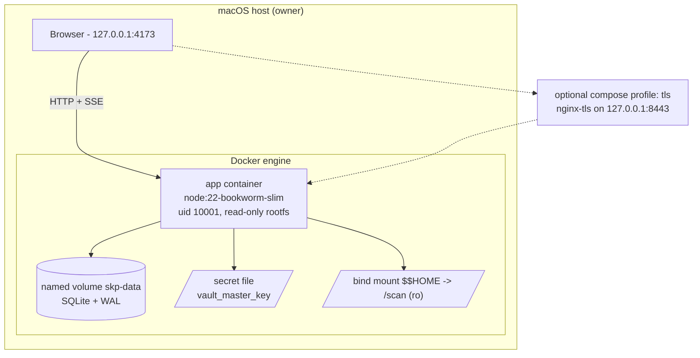
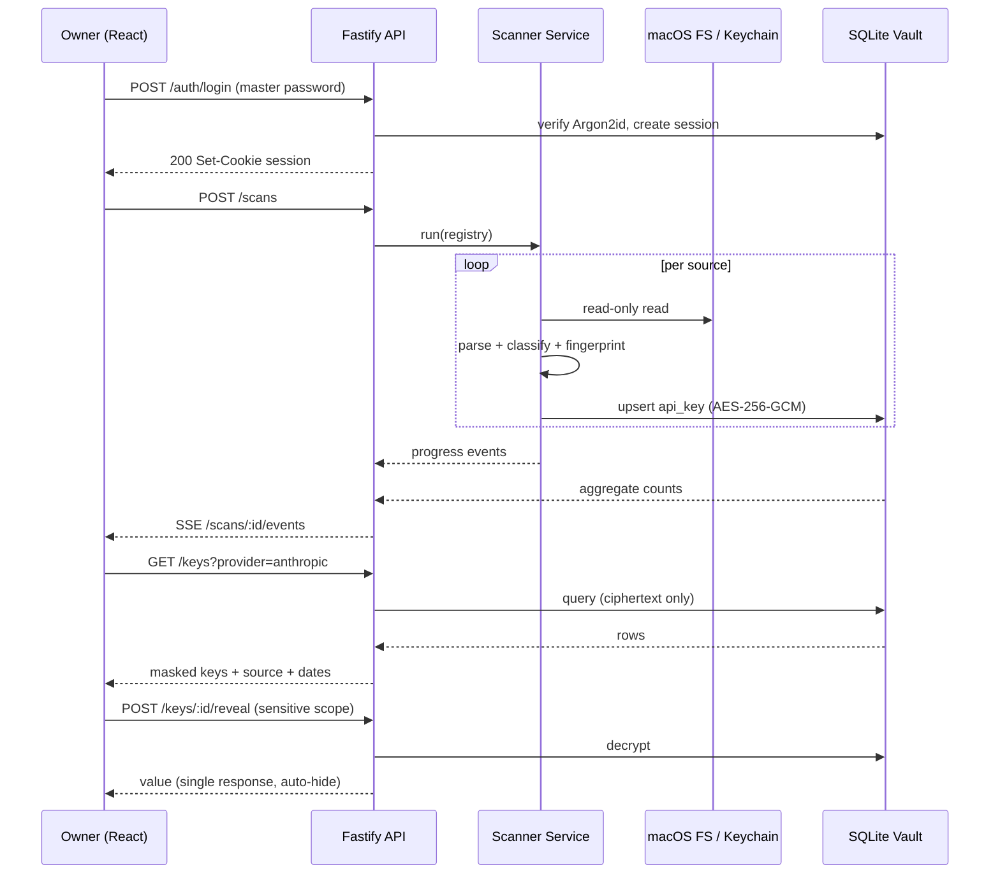
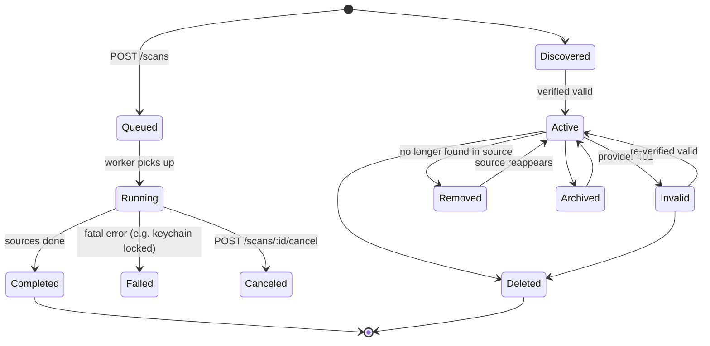
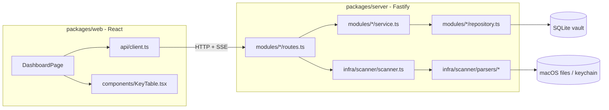

# SecretKeyPreview — Implementation Plan

Workspace: `/Users/wongchimanjack/github/secretkeypreview`
Status: greenfield (repo contains only `AGENT.md`)
Plan author: pi (plan mode, read-only exploration)
Target platform: macOS (owner-only local tool)

---

## 1. Objective & Scope

From `AGENT.md`:

> Create a full-stack application for the owner to scan all API keys of all AI agents & LLM models on the Mac, and preview all API keys inside the Mac.
> Must include a login page (owner only): password authentication + Google authentication.
> Dashboard shows every API key with its relative provider and date added on the MacBook.

**In scope (v1)**
1. Read-only scanner that discovers AI/LLM API keys and OAuth credentials across AI-agent CLIs/IDEs installed on this Mac (files, dotenv/rc files, environment variables, macOS Keychain metadata).
2. Encrypted local vault (SQLite) with provider attribution, source evidence, and "date added" (file mtime + first-seen timestamp).
3. Owner-only access: master-password login and Google OAuth (loopback flow) with an owner email allowlist.
4. Dashboard: masked keys, provider grouping/filtering, key detail with masked reveal behind re-auth, scan history, audit log.
5. Opt-in live key-status verification against provider endpoints.
6. Full docs deliverables per `AGENTS.md` §4 (Program Spec, Function Spec, Infrastructure, Mermaid diagrams, Testing matrix).

**Explicitly out of scope (v1)**
- Multi-user / team sharing, cloud sync, remote access over LAN, mobile app.
- Rewriting or exporting source config files (strictly read-only).
- Broad whole-home filesystem crawl (privacy + noise). Sources come from a curated, user-editable registry.

---

## 2. Technology Decision

| Concern | Decision | Rationale |
|---|---|---|
| Backend runtime | **Node.js 22 LTS+ (26.x installed) + TypeScript 5 strict** | Native macOS interop (`child_process` for `security` CLI, Keychain), file/permission handling, single-language full stack |
| Backend framework | **Fastify 5 + zod + @fastify/* plugins** | Thin layer, schema-first validation, built-in OpenAPI generation |
| ORM / DB | **Drizzle ORM + better-sqlite3 (SQLite/WAL)** | Local single-user tool; typed queries; migrations with rollback; zero external DB service |
| Crypto | **Argon2id (password) + AES-256-GCM (vault), node:crypto** | No third-party信任 surface; master key held in macOS Keychain |
| Auth | **Custom session cookie (master password) + Google OAuth 2.0 loopback (PKCE)** | Loopback flow is the standard for local desktop-ish apps; no public callback URL required |
| Frontend | **React 19 + Vite + TypeScript strict, TanStack Query, Zustand, React Router 7** | Matches `AGENTS.md` React standards; Query gives server-state caching |
| Styling | **Tailwind CSS v4 + design tokens (minimalist, RWD)** | Fast, consistent, mobile-first; muted palette per `AGENTS.md` §3 |
| API docs | **OpenAPI 3.1 generated from zod schemas (contract-first)** | `AGENTS.md` §1 contract-first requirement |
| Tests | **Vitest (server + web), React Testing Library, supertest; Playwright optional e2e** | Same runner for both packages |
| Package manager | **pnpm workspaces (11.22.0 installed)** | Single lockfile, workspace protocol |
| Containerization | **Docker 24+ / buildx, Debian-slim base, compose** | Reproducible builds, self-hosted single-node deployment, no host Node dependency |
| Transport | **HTTPS only — native `node:https` TLS 1.3 (TLS 1.2 floor) + locally trusted cert; optional nginx reverse-proxy profile** | Owner requirement: no plaintext HTTP anywhere; enables `Secure` session cookies |

**Rejected alternatives**
- *Java Spring Boot + Vue*: good enterprise fit, but JNI/JNA for Keychain, `security` CLI plumbing, and slower feedback loop for a single-user local tool. Would only win if this must integrate into an existing Spring estate.
- *Electron/Tauri desktop app*: doubles the surface (native packaging, updater) for v1; the local web app with `127.0.0.1` binding is sufficient and easier to test. Revisit as v2 "menu-bar app" if the owner wants a dock icon.
- *Storing plaintext keys in SQLite*: rejected — vault is encrypted at rest, always.
- *Browser-based File System Access API*: insufficient (no Keychain, no dotfiles, no env).

---

## 3. Repository Structure (pnpm workspaces)

```
// secretkeypreview/
AGENT.md
docs/                                    # deliverables, see §12
  IMPLEMENTATION_PLAN.md
  SPECIFICATION.md                       # program spec (created in Phase 7)
  FUNCTION_SPEC.md
  INFRASTRUCTURE.md
  DIAGRAMS.md
  TESTING.md
docker/
  Dockerfile                                      # multi-stage image (node:22-bookworm-slim)
  docker-entrypoint.sh                            # migrate + boot
  nginx.conf                                      # optional TLS termination (compose profile: tls)
scripts/
  setup-tls.sh                                    # issue local cert + trust it (macOS keychain)
  build-docker.sh                                 # image build (single/multi-arch, push, tar)
  deploy.sh                                       # local / remote / rollback / logs / status / stop
  scan-check.sh                                   # pre-deploy smoke: scan fixtures, assert counts
Makefile
.dockerignore
docker-compose.yml                               # local + single-host deployment stack
contracts/
  openapi.yaml                           # contract-first source of truth (checked in)
  schemas/*.ts                           # shared zod schemas + inferred TS types
packages/
  server/
    drizzle.config.ts
    package.json
    src/
      main.ts                            # entrypoint (listen 127.0.0.1)
      app.ts                             # Fastify build (plugins, error handler)
      config/env.ts                      # env validation (zod), fail fast
      core/
        errors/app-error.ts
        errors/error-handler.ts
        logging/logger.ts                # pino, redaction, traceId
        crypto/vault.ts
        crypto/password.ts
        crypto/google-id-token.ts
        http/session.ts
        http/rate-limit.ts
      modules/
        auth/ (routes, service, repository, dto)
        keys/ (routes, service, repository)
        scans/ (routes, service, runner, progress)
        sources/ (registry, repository)
        providers/ (registry)
        settings/
        audit/
      infra/
        db/schema.ts, db/client.ts, migrations/*.sql
        scanner/
          source-registry.ts
          runners/file-runner.ts, env-runner.ts, keychain-runner.ts
          parsers/json, yaml, toml, dotenv, keychain
          classify/provider-classifier.ts
          scanner.ts (orchestrator)
          types.ts
      plugins/
        auth-guard.ts, sensitive-scope.ts
    test/ (unit + integration fixtures)
  web/
    index.html
    vite.config.ts
    src/
      main.tsx, App.tsx, router.tsx
      api/ (client, endpoints, query-keys)
      hooks/ (useNow, useReauth, useScanProgress)
      components/ (ui primitives, KeyTable, KeyRevealDialog, ScanProgress…)
      features/ (LoginPage, DashboardPage, KeyDetailPage, ScanHistoryPage, SettingsPage, AuditPage)
      stores/ (auth.store.ts)
      styles/tokens.css
      types/ (mirror contracts)
    test/
.env.example
.gitignore
README.md
```

---

## 4. Data Model (Drizzle, SQLite)

Tables: `users`, `google_identities`, `sessions`, `scan_runs`, `api_keys`, `key_events`, `sources`, `audit_logs`, `settings`.

Key highlights:
- `users(id, email, password_hash, created_at, last_login_at)` — single owner row expected; bootstrap enforced when empty.
- `google_identities(user_id, google_sub, email, picture_url, linked_at, unique(google_sub))` + allowlist row in `settings.google_allowed_emails`.
- `sessions(id, user_id, created_at, last_seen_at, absolute_expires_at, idle_expires_at, revoked_at, ip_hash, user_agent_hash)` — rotation on privilege change (`sensitive_scope_until` stored server-side).
- `scan_runs(id, status enum(queued|running|completed|failed|canceled), started_at, finished_at, source_count, new_count, total_count, triggered_by enum(user|schedule), error_code)`.
- `api_keys(id unique, provider, label, masked_value, fingerprint_sha256 unique, cipher_text, iv, auth_tag, source_kind enum(file|env|keychain|secret-file), source_path, source_pointer, env_var_name, first_seen_at, last_seen_at, source_mtime, last_verified_at, verification_status enum(unknown|valid|invalid|error), is_exposed boolean, status enum(active|removed|archived), created_at, updated_at)`.
  - `fingerprint_sha256 = sha256(value)` → global dedupe, never store plaintext, never log.
  - `masked_value` e.g. `sk-ant-api03-AdT…wXyZ` — safe for UI/response bodies.
- `key_events(id, key_id, type enum(discovered|rotated|removed|revealed|verified|archived), at, actor, note)` — audit trail of key lifecycle.
- `audit_logs(id, trace_id, actor, action, target, outcome, ip_hash, user_agent_hash, at)` — append-only, structured.
- `sources(id, kind, path_pattern, enabled, priority, notes)` — own defaults seeded + owner-editable scan registry.
- `settings(id, google_allowed_emails json, idle_timeout_minutes, absolute_session_hours, verify_keys_opt_in boolean, encryption_kdf_params json)`.

Migrations: every migration is reversible (`drizzle-kit` + hand-written `down.sql`); `docs/INFRASTRUCTURE.md` records the apply/rollback commands.

---

## 5. Scanner Design (core differentiator)

### 5.1 Source registry (seeded from verified paths on this machine)

| Source id | Kind | Path | Notes |
|---|---|---|---|
| `codex-auth` | file (json) | `~/.codex/auth.json` | `OPENAI_API_KEY`, `auth_mode` |
| `codex-config` | file (toml) | `~/.codex/config.toml` | provider/model keys |
| `grok-auth` | file (json) | `~/.grok/auth.json` | access + refresh tokens, xAI |
| `bailian-config` | file (json) | `~/.bailian/config.json` | `token-plan.api_key` |
| `arkcli-config` | file (yaml) | `~/.arkcli-bp/config.yaml` | `api_key`, `available_api_keys` |
| `arkcli-env` | file (dotenv) | `~/.arkcli-bp/.env` | ARK_API_KEY etc. |
| `gemini-oauth` | file (json) | `~/.gemini/oauth_creds.json`, `~/.gemini/google_accounts.json` | Google OAuth creds |
| `gemini-settings` | file (json) | `~/.gemini/settings.json` | `security.auth.selectedType` |
| `copilot-config` | file (json) | `~/.copilot/config.json`, `~/.cursor/cli-config.json`, `~/.cursor/mcp.json` | provider tokens |
| `deepseek-token` | file (rawRegex) | `~/.deepseek/token/` | any file in dir |
| `qwen-settings` | file (json/yaml) | `~/.qwen/settings.json`, `~/.qwen/` | `env.*` keys incl. BAILIAN/DASHSCOPE |
| `continue-config` | file (yaml) | `~/.continue/config.yaml`, `~/.continue/.continuerc.json` | `apiKey` per provider block |
| `opencode-config` | file (jsonc) | `~/.config/opencode/opencode.jsonc`, `~/.config/opencode/auth.json` | provider api keys |
| `claude-session-env` | file (env) | `~/.claude/session-env/*` | per-session env exports |
| `claude-config` | file (json) | `~/.claude.json` | env/provider hints, `apiKeyHelper` (noted, not harvested) |
| `ollama-config` | file (json) | `~/.ollama/config.json` | cloud API keys |
| `colab-token` | file (json) | `~/.config/colab-cli/token.json` | Google credential |
| `docker-auth` | file (json) | `~/.docker/config.json`, `~/.config/configstore/*` | registry auth tokens |
| `aws-*` | file (ini) | `~/.aws/credentials`, `~/.aws/config`, `~/.aws/sso/cache/*.json` | Bedrock/Anthropic-on-AWS keys |
| `shell-env` | env file | `~/.zshrc`, `~/.zprofile`, `~/.bash_profile`, `~/.profile` | `export ANTHROPIC_API_KEY=…` |
| `git-credentials` | file (rawRegex) | `~/.git-credentials`, `~/.config/git/*` | GitHub PATs |
| `npm/pypi` | file | `~/.npmrc`, `~/.pip`, `~/.pypirc` | registry tokens |
| `keychain-generic` | keychain | login keychain generic passwords | metadata enumeration via `security` CLI |

View of scan roots is stable across sessions; registry seeded in seed migration and editable in Settings UI. Owners can add paths (single file or glob) for anything not covered.

### 5.2 Pipeline

1. **Load enabled sources** → normalize `~` → read-only handles.
2. **Parse** by parser type: `json` (JSONC tolerant), `yaml`, `toml`, `dotenv`, `rawRegex`, `keychain`.
3. **Extract candidates**: walk parsed structures, keep every scalar whose *key name* matches `/(api[_-]?key|token|secret|password|credential|access[_-]?key|refresh[_-]?token)/i` plus regex hits from raw text (value patterns that look like keys even if key name is innocuous).
4. **Classify** provider: value-prefix table first (authoritative), then env-var/key-name hint table, then source default. Emit `provider`, `label`, `evidence{path, pointer, envVar}`.
5. **Normalize**: trim, reject known placeholders (`...`, `changeme`, `<...>`, `your-api-key`), reject booleans/numbers.
6. **Fingerprint** `sha256(value)`; if row exists → bump `last_seen_at` + `key_events` no-op; else insert with ciphertext.
7. **Diff**: keys not seen in run and older than run start → mark `status=removed` (record `key_events.type=removed`, keep history until owner deletes).
8. **Emit progress** via in-process event emitter → SSE `/api/v1/scans/:id/events` for live dashboard progress.

### 5.3 Provider prefix registry (v1 subset)

| Provider | Prefix / signature | Env hints |
|---|---|---|
| Anthropic | `sk-ant-`, `sk-ant-api03-`, `sk-ant-oat01-` | `ANTHROPIC_API_KEY` |
| OpenAI / Codex | `sk-proj-`, `sk-`, `sess-` | `OPENAI_API_KEY`, `OPENAI_ORG_ID` |
| Google AI Studio | `AIza…` | `GOOGLE_API_KEY`, `GEMINI_API_KEY` |
| xAI / Grok | `xai-` | `XAI_API_KEY` |
| BytePlus Ark | `ark-` | `ARK_API_KEY` |
| Bailian / DashScope | `sk-…` + config context `bailian` | `DASHSCOPE_API_KEY`, `BAILIAN_TOKEN_PLAN_API_KEY` |
| Groq | `gsk_` | `GROQ_API_KEY` |
| OpenRouter | `sk-or-` | `OPENROUTER_API_KEY` |
| Mistral | `…` (context `mistral`) | `MISTRAL_API_KEY` |
| Perplexity | `pplx-` | `PERPLEXITY_API_KEY` |
| Cohere / Together / Fireworks / DeepInfra / Cerebras | `co-`, `togai-`, `fw_`, `di-`, `csk-` | matching env names |
| Hugging Face | `hf_` | `HUGGINGFACE_API_KEY` |
| GitHub | `ghp_`, `gho_`, `ghu_`, `ghs_`, `ghr_`, `github_pat_` | `GH_TOKEN`, `GITHUB_TOKEN` |
| npm / PyPI | `npm_`, `pypi-` | `NPM_TOKEN`, `PYPI_TOKEN` |
| Google OAuth | `refresh_token` + `client_id` mail in same doc | `GOOGLE_*` |
| Azure OpenAI | `https://*.openai.azure.com` + key-length blob | `AZURE_OPENAI_API_KEY` |
| AWS | `AKIA…` (`ASIA…` = temporary) | `AWS_ACCESS_KEY_ID` |
| Ollama Cloud | `oll_` | `OLLAMA_API_KEY` |
| Moonshot / GLM / MiniMax / SiliconFlow / Novita | `sk-` + context | provider from env hint/context |
| GitHub Copilot | `gho_`/PAT in `~/.copilot` | `COPILOT_*` |

Unknown-but-credential-shaped values are stored with `provider='unknown'` + `label=<source>` so the owner can triage — never dropped silently.

### 5.4 Keychain handling (macOS)
- Enumerate metadata with `security find-generic-password` / `dump-keychain` for a curated service list (`Claude Code`, `Codex`, `opencode`, `Gemini`, `Cursor`, `Copilot`, `grok`, `deepseek`, `ollama`, …) and store `{service, account, where}`; classify by account like `…api key`.
- Secret values are read only on explicit owner reveal (re-auth required). Metadata rows are created as `SourceEvidence` without ciphertext.
- Unlock prompt happens once per scan; if locked → scan records `status=failed`, `error_code=KEYCHAIN_LOCKED`, UI shows actionable hint.

---

## 6. Security Model

- **Binding**: server listens on `127.0.0.1:<PORT>` only (default 4173).
- **Transport**: HTTPS only (TLS 1.3, TLS 1.2 floor). Native mode runs `node:https` with a locally-issued certificate trusted in the macOS login keychain (Chrome/Safari honor it); the container runs the *same TLS-enabled image*. No plaintext listener is published — `SKP_ENABLE_HTTP_REDIRECT` may expose a loopback-only 308 redirector. Cookies are `Secure`, so an HTTP downgrade cannot yield a usable session.
- **Passwords**: Argon2id (m=64MiB, t=3, p=1) + per-user salt.
- **Vault**: master key stored as generic password in the macOS login keychain (`security add-generic-password -s SecretKeyPreview.vault`), generated with `crypto.randomBytes(32)`; fallback = Argon2id KDF over master password if keychain unavailable. Per-record envelope: `AES-256-GCM(value, iv, aad=keyId)`, auth tag verified on read (tamper → `VaultDecryptionError` → audit event).
- **Sessions**: opaque id in httpOnly, `SameSite=Strict` cookie; server-side row; idle 30 min / absolute 12 h; rotate on password change; logout revokes; `traceId` per request.
- **Re-auth gate**: reveal/verify/delete of a key require `sensitive` scope obtained via `POST /auth/verify-password` (5 min TTL, single session-scoped).
- **Logging**: pino, redaction paths for `*.value`, `*.cipher_text`, `authorization`, `cookie`; never log key material; tests assert redaction.
- **Error surface**: `@RestControllerAdvice` analogue — central `setErrorHandler` returning `ApiErrorResponse{ code, message, data, timestamp, traceId }`; no stack traces to client.
- **Rate limiting**: auth routes strict (5 attempts / 5 min / IP+account, lockout + audit), scan trigger 1/min.
- **Repo hygiene**: `.gitignore` for `*.db`, `.env`, `dist`, `secrets/`; fixture data uses fake keys only; CI scan job (`gitleaks`) fails on accidental secrets.
- Note: the git repository on this machine is rooted at `$HOME`; the plan includes detaching a dedicated local repo inside `secretkeypreview/` (fresh `git init`) so the project is versioned independently.

---

## 7. API Contract (v1, `/api/v1`, OpenAPI 3.1 in `contracts/openapi.yaml`)

| Method | Path | Purpose |
|---|---|---|
| GET | `/health` | liveness + build info |
| GET | `/auth/status` | `{ needsBootstrap, methods: [password, google], googleConfigured }` |
| POST | `/auth/bootstrap` | create owner account (master password), enable Google optional |
| POST | `/auth/login` | password login → session cookie |
| POST | `/auth/logout` | revoke session |
| POST | `/auth/verify-password` | re-auth → sensitive scope |
| GET | `/auth/google/start` | issue state+nonce+PKCE, return consent URL |
| GET | `/auth/google/callback` | HTTPS loopback redirect handler (exchange + id_token verify + allowlist); registered URI: `https://127.0.0.1:4173/api/v1/auth/google/callback` |
| GET/PUT | `/settings` | Google allowlist, timeouts, verify opt-in |
| GET | `/sources` | scan registry |
| PUT | `/sources/:id` | enable/disable, edit path/priority |
| GET | `/providers` | provider registry (labels + docs links) |
| GET | `/keys` | paged, filter by provider/status/source, sort by `source_mtime`/`first_seen_at` |
| GET | `/keys/:id` | detail incl. evidence, history, masked only |
| POST | `/keys/:id/reveal` | sensitive scope → full value once, auto-cleared after 30 s |
| POST | `/keys/:id/verify` | opt-in live provider probe |
| PATCH | `/keys/:id` | label, tags, archive |
| DELETE | `/keys/:id` | delete + event |
| GET | `/scans` | history |
| POST | `/scans` | trigger (rate limited) |
| GET | `/scans/:id` | run detail |
| GET | `/scans/:id/events` | SSE progress |
| POST | `/scans/:id/cancel` | cooperative cancel |
| GET | `/audit` | paginated audit trail |

Response envelope: `{ code, message, data, timestamp, traceId }` on success and error.

---

## 8. Frontend Design

- **Pages**: `/login` (tabbed: password | Google), `/` dashboard, `/keys/:id` detail, `/scans` history, `/settings`, `/audit`.
- **Login**: minimalist centered card, muted palette, single accent color, keyboard-first, inline validation, Google button via redirect URL from backend (never a client secret).
- **Dashboard**: summary cards (total keys, providers, last scan, needing attention), filters (provider, status, source kind, search), table with masked value + provider badge + source path + **date added** (`source_mtime` primary, `first_seen_at` fallback, both shown in detail), sortable columns, mobile → card list under `sm`.
- **Detail drawer/page**: full evidence chain (file → JSON pointer), key lifecycle timeline, Reveal (gated, countdown auto-hide), Verify (opt-in), rotate/delete with confirm.
- **Scan UX**: trigger button, SSE progress bar with per-source log lines, cancel.
- **Tech rules** (per `AGENTS.md`): `any` forbidden; all payloads typed from `contracts/schemas/*.ts`; HTTP only in `api/`; cleanup of SSE/timers in `useEffect`; `React.memo` on table rows; error boundary; optimistic UI only for label/tag edits.
- **Accessibility**: focus rings, `aria-live` on scan progress, `aria-label` on masked values, table headings scope, contrast ≥ 4.5:1.

---

## 8A. Containerization (Docker) & Deployment Scripts

### 8A.0 Image design decisions
- Base `node:22.14.0-bookworm-slim` (Debian/glibc), **not** Alpine/musl: `better-sqlite3` ships prebuilt glibc binaries; Alpine would force a from-source native compile on every build.
- Multi-stage: `deps` (lockfile-only `pnpm fetch`) → `build` (web vite build + server `tsc` build + `pnpm deploy --prod`) → `runtime` (prod `node_modules` only, no compilers, non-root uid 10001).
- Inside the container the app binds `0.0.0.0`; the **security boundary is port publishing** (`127.0.0.1:${SKP_PORT}:4173`). Never publish on `0.0.0.0` without TLS.
- The macOS **Keychain is unreachable from inside a container** → container deployments must supply the vault master key via `SKP_VAULT_MASTER_KEY_FILE` (preferred) or `SKP_VAULT_MASTER_PASSWORD` (Argon2id seed). Keychain metadata enumeration reports "unavailable"; file/env scanning still works by mounting the scan root read-only (`SKP_SCAN_ROOT`). The native (non-container) run remains the primary mode on the owner's Mac.
- Runtime container is hardened: `read_only: true` rootfs, `tmpfs: /tmp`, `cap_drop: ALL`, `no-new-privileges`, non-root user, log rotation caps, healthcheck.

### 8A.1 Environment contract (`.env.example` will ship these)

| Variable | Default | Notes |
|---|---|---|
| `SKP_HOST` | `127.0.0.1` (native) / `0.0.0.0` (image ENV) | bind address |
| `SKP_PORT` | `4173` | **HTTPS** port (TLS 1.3); the app never serves plaintext on this port |
| `SKP_DATA_DIR` | `./data` | SQLite directory; must be writable by the runtime user |
| `SKP_DB_FILE` | `secretkeypreview.db` | database filename inside `SKP_DATA_DIR` |
| `SKP_LOG_LEVEL` | `info` | pino level |
| `SKP_VAULT_MASTER_KEY_FILE` | – | 32-byte base64 key; container path `/run/secrets/vault_master_key` |
| `SKP_VAULT_MASTER_PASSWORD` | – | Argon2id seed when no keychain (never logged) |
| `SKP_GOOGLE_CLIENT_ID` / `SKP_GOOGLE_CLIENT_SECRET` | – | OAuth loopback redirect `http://127.0.0.1:${SKP_PORT}/api/v1/auth/google/callback` |
| `SKP_GOOGLE_ALLOWED_EMAILS` | – | comma-separated owner allowlist |
| `SKP_VERIFY_KEYS_OPT_IN` | `false` | enable live provider probes |
| `SKP_SCAN_ROOT` | `~` (native) / `/scan` (container) | root resolved by source registry |
| `SKP_SESSION_IDLE_MINUTES` / `SKP_SESSION_ABSOLUTE_HOURS` | `30` / `12` | session lifetime |
| `SKP_TLS_CERT_PATH` / `SKP_TLS_KEY_PATH` | `./certs/localhost.pem` / `./certs/localhost-key.pem` | full chain (leaf + intermediate/CA) and private key, absolute paths in `.env` |
| `SKP_TLS_MIN_VERSION` | `TLSv1.3` | protocol floor (`TLSv1.2` fallback for old clients) |
| `SKP_PUBLIC_ORIGIN` | `https://127.0.0.1:4173` | origin used to build the Google redirect URI, HSTS and OAuth state checks |
| `SKP_ENABLE_HTTP_REDIRECT` | `false` | when `true`, a second **loopback-only** listener on `SKP_HTTP_REDIRECT_PORT` (4180) issues `308` → HTTPS; it never serves content |
| `SKP_CERTS_DIR` | `./certs` | output directory of `scripts/setup-tls.sh` |

### 8A.2 Files to create

```dockerfile
# docker/Dockerfile
# syntax=docker/dockerfile:1.7

ARG NODE_IMAGE=node:22.14.0-bookworm-slim

# ---------- shared base ----------
FROM ${NODE_IMAGE} AS base
ENV PNPM_HOME=/pnpm \
    PATH=/pnpm:/usr/local/sbin:/usr/local/bin:/usr/sbin:/usr/bin:/sbin:/bin \
    CI=true
RUN corepack enable && corepack prepare pnpm@10.15.6 --activate

# ---------- deps: install strictly from the lockfile ----------
FROM base AS deps
WORKDIR /app
RUN apt-get update \
 && apt-get install -y --no-install-recommends python3 make g++ ca-certificates \
 && rm -rf /var/lib/apt/lists/*
COPY pnpm-lock.yaml pnpm-workspace.yaml package.json ./
COPY packages/server/package.json packages/server/
COPY packages/web/package.json packages/web/
COPY contracts ./contracts
RUN pnpm fetch

# ---------- build ----------
FROM base AS build
WORKDIR /app
RUN apt-get update \
 && apt-get install -y --no-install-recommends python3 make g++ ca-certificates \
 && rm -rf /var/lib/apt/lists/*
COPY --from=deps /app/node_modules ./node_modules
COPY . .
RUN pnpm install --offline --frozen-lockfile \
 && pnpm --filter @skp/server build \
 && pnpm --filter @skp/web build \
 && pnpm --filter @skp/server deploy --prod /prod \
 && cp -R ./contracts /prod/contracts \
 && mkdir -p /prod/packages/web \
 && cp -R ./packages/web/dist /prod/packages/web/dist

# ---------- runtime ----------
FROM ${NODE_IMAGE} AS runtime
ARG VERSION=dev
ARG VCS_REF=unknown
ARG BUILD_DATE=unknown

LABEL org.opencontainers.image.title="SecretKeyPreview" \
      org.opencontainers.image.version="${VERSION}" \
      org.opencontainers.image.revision="${VCS_REF}" \
      org.opencontainers.image.created="${BUILD_DATE}"

ENV NODE_ENV=production \
    SKP_HOST=0.0.0.0 \
    SKP_PORT=4173 \
    SKP_DATA_DIR=/data \
    SKP_LOG_LEVEL=info

WORKDIR /app
RUN apt-get update \
 && apt-get install -y --no-install-recommends ca-certificates \
 && rm -rf /var/lib/apt/lists/* \
 && groupadd --gid 10001 skp \
 && useradd --uid 10001 --gid 10001 --create-home --shell /usr/sbin/nologin skp \
 && mkdir -p /data /run/secrets \
 && chown skp:skp /data /run/secrets

COPY --from=build --chown=skp:skp /prod/node_modules ./node_modules
COPY --from=build --chown=skp:skp /prod/package.json ./package.json
COPY --from=build --chown=skp:skp /app/packages/server/dist ./packages/server/dist
COPY --from=build --chown=skp:skp /prod/contracts ./contracts
COPY --from=build --chown=skp:skp /prod/packages/web/dist ./packages/web/dist
COPY --chown=root:root --chmod=0755 docker/docker-entrypoint.sh /usr/local/bin/skp-entrypoint

USER skp
EXPOSE 4173

HEALTHCHECK --interval=30s --timeout=5s --start-period=15s --retries=3 \
  CMD ["node", "-e", "const p=process.env.SKP_PORT||4173;fetch('http://127.0.0.1:'+p+'/health').then(r=>process.exit(r.ok?0:1)).catch(()=>process.exit(1))"]

ENTRYPOINT ["skp-entrypoint"]
```

```bash
# docker/docker-entrypoint.sh
#!/usr/bin/env bash
set -Eeuo pipefail

log() { printf '[skp-entrypoint] %s\n' "$*"; }
die() { printf '[skp-entrypoint] FATAL: %s\n' "$*" >&2; exit 1; }

SKP_DATA_DIR="${SKP_DATA_DIR:-/data}"
SKP_PORT="${SKP_PORT:-4173}"
SKP_MIGRATIONS="${SKP_MIGRATIONS:-true}"

[ -d "$SKP_DATA_DIR" ] || mkdir -p "$SKP_DATA_DIR" 2>/dev/null || die "cannot create $SKP_DATA_DIR"
[ -w "$SKP_DATA_DIR" ] || die "data dir not writable: $SKP_DATA_DIR (mount a volume)"

SKP_TLS_CERT_PATH="${SKP_TLS_CERT_PATH:-/certs/localhost.pem}"
SKP_TLS_KEY_PATH="${SKP_TLS_KEY_PATH:-/certs/localhost-key.pem}"
for f in "$SKP_TLS_CERT_PATH" "$SKP_TLS_KEY_PATH"; do
  [ -r "$f" ] || die "TLS material unreadable: $f (run scripts/setup-tls.sh, mount ./certs)"
done
log "TLS enabled: ${SKP_TLS_CERT_PATH} (min ${SKP_TLS_MIN_VERSION:-TLSv1.3})"

if [ "${SKP_VAULT_MASTER_KEY_FILE:-}" != "" ]; then
  [ -r "${SKP_VAULT_MASTER_KEY_FILE}" ] || die "vault key unreadable: ${SKP_VAULT_MASTER_KEY_FILE}"
  log "vault master key source: ${SKP_VAULT_MASTER_KEY_FILE}"
else
  log "vault master key source: Argon2id(SKP_VAULT_MASTER_PASSWORD)"
fi

if [ "$SKP_MIGRATIONS" = "true" ]; then
  log "applying migrations"
  node ./packages/server/dist/infra/db/migrate.js || die "migration failed"
fi

log "starting server on ${SKP_HOST:-0.0.0.0}:${SKP_PORT}"
exec node ./packages/server/dist/main.js
```

```yaml
# docker-compose.yml
name: secretkeypreview

# NOTE: compose does NOT expand '~'. Use absolute paths for SKP_SCAN_ROOT /
# SKP_VAULT_MASTER_KEY_FILE, e.g. SKP_SCAN_ROOT=/Users/wongchimanjack
services:
  app:
    image: ${SKP_IMAGE_NAME:-secretkeypreview}:${SKP_IMAGE_TAG:-latest}
    build:
      context: .
      dockerfile: docker/Dockerfile
      args:
        NODE_IMAGE: ${NODE_IMAGE:-node:22.14.0-bookworm-slim}
        VERSION: ${SKP_IMAGE_TAG:-latest}
        VCS_REF: ${VCS_REF:-unknown}
    init: true
    restart: unless-stopped
    user: "10001:10001"
    ports:
      - "127.0.0.1:${SKP_PORT:-4173}:4173"
    env_file:
      - .env
    environment:
      SKP_HOST: "0.0.0.0"
      SKP_PORT: "4173"
      SKP_DATA_DIR: "/data"
      SKP_SCAN_ROOT: "/scan"
      SKP_TLS_CERT_PATH: "/certs/localhost.pem"
      SKP_TLS_KEY_PATH: "/certs/localhost-key.pem"
      SKP_PUBLIC_ORIGIN: "https://127.0.0.1:${SKP_PORT:-4173}"
    volumes:
      - skp-data:/data
      - ${SKP_VAULT_MASTER_KEY_FILE:-./secrets/vault_master_key}:/run/secrets/vault_master_key:ro
      - ${SKP_SCAN_ROOT:-/Users/wongchimanjack}:/scan:ro
      - ${SKP_CERTS_DIR:-./certs}:/certs:ro
    read_only: true
    tmpfs:
      - /tmp
    security_opt:
      - no-new-privileges:true
    cap_drop:
      - ALL
    healthcheck:
      test:
        - CMD
        - node
        - -e
        - "const p=process.env.SKP_PORT||4173;fetch('http://127.0.0.1:'+p+'/health').then(r=>process.exit(r.ok?0:1)).catch(()=>process.exit(1))"
      interval: 30s
      timeout: 5s
      retries: 3
      start_period: 15s
    logging:
      driver: json-file
      options:
        max-size: "10m"
        max-file: "5"

  nginx-tls:
    profiles: ["tls"]
    image: nginx:1.27-alpine
    restart: unless-stopped
    ports:
      - "127.0.0.1:${SKP_TLS_PORT:-8443}:8443"
    volumes:
      - ./docker/nginx.conf:/etc/nginx/conf.d/default.conf:ro
      - ./certs:/etc/nginx/certs:ro
    depends_on:
      - app

volumes:
  skp-data:
```

```nginx
# docker/nginx.conf
# Optional hardening reverse-proxy. The app already terminates TLS itself
# (scripts/setup-tls.sh), so this profile is only needed for LAN sharing,
# client-cert / filtering, or extra defence-in-depth:
#   docker compose --profile tls up -d
server {
    listen 8443 ssl;
    http2 on;
    server_name localhost;

    ssl_certificate     /etc/nginx/certs/localhost.pem;
    ssl_certificate_key /etc/nginx/certs/localhost-key.pem;
    ssl_protocols       TLSv1.2 TLSv1.3;
    ssl_ciphers         HIGH:!aNULL:!MD5;
    ssl_session_cache   shared:SSL:10m;

    add_header Strict-Transport-Security "max-age=31536000" always;
    add_header X-Content-Type-Options    nosnpos always;
    add_header Referrer-Policy           no-referrer      always;

    # SSE scan-progress must never be buffered
    location / {
        proxy_pass         https://app:4173;
        proxy_ssl_verify   off;      # app cert is a trusted local cert, not a public CA
        proxy_ssl_server_name on;
        proxy_http_version 1.1;
        proxy_set_header   Host              $host;
        proxy_set_header   X-Real-IP         $remote_addr;
        proxy_set_header   X-Forwarded-For   $proxy_add_x_forwarded_for;
        proxy_set_header   X-Forwarded-Proto $scheme;
        proxy_set_header   Upgrade           $http_upgrade;
        proxy_set_header   Connection        "upgrade";
        proxy_buffering    off;
        proxy_read_timeout 1h;
    }
}
```

```bash
# scripts/build-docker.sh
#!/usr/bin/env bash
# Builds (and optionally pushes / tars) the SecretKeyPreview image with docker buildx.
set -Eeuo pipefail

IMAGE_NAME="${IMAGE_NAME:-secretkeypreview}"
REGISTRY="${REGISTRY:-}"
VERSION="${VERSION:-$(node -p "require('./package.json').version")}"
GIT_SHA="${GIT_SHA:-$(git rev-parse --short HEAD 2>/dev/null || echo unknown)}"
NODE_IMAGE="${NODE_IMAGE:-node:22.14.0-bookworm-slim}"
DOCKERFILE="${DOCKERFILE:-docker/Dockerfile}"
CONTEXT="${CONTEXT:-.}"
PLATFORMS="${PLATFORMS:-}"
PUSH="${PUSH:-false}"
NO_CACHE="${NO_CACHE:-false}"
PROGRESS="${PROGRESS:-auto}"
TAR_OUT="${TAR_OUT:-}"

log()  { printf '\033[0;36m[build]\033[0m %s\n' "$*"; }
warn() { printf '\033[0;33m[build]\033[0m %s\n' "$*" >&2; }
die()  { printf '\033[0;31m[build]\033[0m %s\n' "$*" >&2; exit 1; }

command -v docker >/dev/null 2>&1 || die "docker not found in PATH"
command -v node   >/dev/null 2>&1 || die "node not found in PATH"
docker buildx version >/dev/null 2>&1 || die "docker buildx not available"

full_image() {
  if [ -n "$REGISTRY" ]; then printf '%s/%s' "$REGISTRY" "$IMAGE_NAME"; else printf '%s' "$IMAGE_NAME"; fi
}

if [ -z "$PLATFORMS" ]; then
  arch="$(docker version --format '{{.Server.Arch}}' 2>/dev/null || true)"
  case "$arch" in
    x86_64|amd64)          PLATFORMS="linux/amd64" ;;
    aarch64|arm64|arm64/v8) PLATFORMS="linux/arm64" ;;
    "") die "cannot detect docker arch; set PLATFORMS explicitly (e.g. linux/amd64,linux/arm64)" ;;
    *)   die "unsupported docker arch: $arch" ;;
  esac
fi

if [ "$PUSH" = "true" ] && [ -z "$REGISTRY" ]; then
  warn "PUSH=true without REGISTRY; falling back to a local image"
  PUSH="false"
fi

if printf '%s' "$PLATFORMS" | grep -q ',' && [ "$PUSH" != "true" ] && [ -z "$TAR_OUT" ]; then
  die "multi-platform builds must be pushed (PUSH=true REGISTRY=...) or exported (TAR_OUT=...)"
fi

if [ -n "$TAR_OUT" ]; then
  mkdir -p "$(dirname "$TAR_OUT")"
fi

BUILD_ARGS=(
  --platform "$PLATFORMS"
  --file "$DOCKERFILE"
  --build-arg "NODE_IMAGE=$NODE_IMAGE"
  --build-arg "VERSION=$VERSION"
  --build-arg "BUILD_DATE=$(date -u +%Y-%m-%dT%H:%M:%SZ)"
  --build-arg "VCS_REF=$GIT_SHA"
  --label "org.opencontainers.image.title=SecretKeyPreview"
  --label "org.opencontainers.image.version=$VERSION"
  --label "org.opencontainers.image.revision=$GIT_SHA"
  --label "com.secretkeypreview.image.platforms=$PLATFORMS"
  -t "$(full_image):$VERSION"
  -t "$(full_image):sha-$GIT_SHA"
  -t "$(full_image):latest"
  --progress "$PROGRESS"
)

[ "$NO_CACHE" = "true" ] && BUILD_ARGS+=(--no-cache)

if [ -n "$TAR_OUT" ]; then
  BUILD_ARGS+=(--output "type=docker,dest=$TAR_OUT")
elif [ "$PUSH" = "true" ]; then
  BUILD_ARGS+=(--push)
else
  BUILD_ARGS+=(--load)
fi

log "image=$(full_image) version=$VERSION platforms=$PLATFORMS push=$PUSH"
docker buildx build "$CONTEXT" "${BUILD_ARGS[@]}"

if [ -n "$TAR_OUT" ]; then
  log "image archive: $TAR_OUT"
else
  log "built $(full_image):$VERSION"
fi
log "run locally: docker run --rm -p 127.0.0.1:4173:4173 -v \"$(pwd)/certs:/certs:ro\" --env-file .env $(full_image):$VERSION"
```

```bash
# scripts/deploy.sh
#!/usr/bin/env bash
# Deployment helper: local (compose), remote (ssh + docker load), rollback, logs, status, stop.
set -Eeuo pipefail

CMD="${1:-help}"
[ $# -gt 0 ] && shift

COMPOSE_FILE="${COMPOSE_FILE:-docker-compose.yml}"
ENV_FILE="${ENV_FILE:-.env}"
IMAGE_NAME="${IMAGE_NAME:-secretkeypreview}"
IMAGE_TAG="${SKP_IMAGE_TAG:-latest}"
REMOTE_HOST="${REMOTE_HOST:-}"
REMOTE_USER="${REMOTE_USER:-root}"
REMOTE_DIR="${REMOTE_DIR:-/opt/secretkeypreview}"
PORT="${SKP_PORT:-4173}"
# HTTPS by default; -k tolerates the locally-issued (keychain-trusted) cert
HEALTH_URL="https://127.0.0.1:${PORT}/health"
CURL="curl -kfsS"
SSH=(ssh -o BatchMode=yes -o StrictHostKeyChecking=accept-new "${REMOTE_USER}@${REMOTE_HOST}")

log()  { printf '\033[0;36m[deploy]\033[0m %s\n' "$*"; }
warn() { printf '\033[0;33m[deploy]\033[0m %s\n' "$*" >&2; }
die()  { printf '\033[0;31m[deploy]\033[0m %s\n' "$*" >&2; exit 1; }

require_docker() { command -v docker >/dev/null 2>&1 || die "docker not found in PATH"; }
require_env()    { [ -f "$ENV_FILE" ] || die "missing $ENV_FILE (cp .env.example $ENV_FILE)"; }

usage() {
  cat <<'EOF'
Usage: deploy.sh <command> [args]

Commands:
  local                build + run docker-compose on this host (127.0.0.1 only)
  remote               ship compose + .env + image to $REMOTE_HOST and start it
  rollback <tag>       redeploy a previously loaded image tag on $REMOTE_HOST
  logs                 follow container logs
  status               show container status
  stop                 stop the stack (keeps the data volume)

Key environment variables:
  SKP_IMAGE_TAG             image tag to deploy (default: latest)
  SKP_PORT                  host port mapped to the container (default: 4173)
  REMOTE_HOST               user@host for remote deploy
  REMOTE_DIR                target directory on the remote host
  SKP_VAULT_MASTER_KEY_FILE path to the 32-byte base64 vault key
  SKP_SCAN_ROOT             absolute host path mounted read-only into the container

Examples:
  ./scripts/deploy.sh local
  REMOTE_HOST=jack@mac-mini.local SKP_IMAGE_TAG=1.0.0 ./scripts/deploy.sh remote
  REMOTE_HOST=jack@mac-mini.local ./scripts/deploy.sh rollback 0.9.4
EOF
}

compose() { docker compose --file "$COMPOSE_FILE" --env-file "$ENV_FILE" "$@"; }

ensure_vault_key() {
  local key
  key="$(grep -E '^[[:space:]]*SKP_VAULT_MASTER_KEY_FILE=' "$ENV_FILE" 2>/dev/null | cut -d= -f2- | tr -d '\"' || true)"
  [ -n "$key" ] || key="./secrets/vault_master_key"
  if [ ! -f "$key" ]; then
    mkdir -p "$(dirname "$key")"
    openssl rand -base64 32 > "$key"
    log "generated vault master key: $key"
  fi
  chmod 600 "$key"
  warn "the vault key unlocks every stored API key - back it up or lose access forever"
}

wait_healthy() {
  local i
  for i in $(seq 1 30); do
    if curl -kfsS "$HEALTH_URL" >/dev/null 2>&1; then
      log "health check OK -> $HEALTH_URL"
      return 0
    fi
    sleep 2
  done
  warn "health check did not pass in 60s; inspect with: ./scripts/deploy.sh logs"
  return 1
}

local_up() {
  require_docker
  require_env
  ensure_vault_key
  log "building and starting stack ($COMPOSE_FILE)"
  compose up -d --build
  wait_healthy || true
  log "open https://127.0.0.1:${PORT}"
}

remote_up() {
  require_docker
  [ -n "$REMOTE_HOST" ] || die "set REMOTE_HOST=user@host"
  require_env
  log "preparing remote host ${REMOTE_HOST}:${REMOTE_DIR}"
  "${SSH[@]}" "mkdir -p '${REMOTE_DIR}'"
  tar -czf - "$COMPOSE_FILE" "$ENV_FILE" docker \
    | "${SSH[@]}" "cd '${REMOTE_DIR}' && tar -xzmf -"
  log "transferring image ${IMAGE_NAME}:${IMAGE_TAG}"
  docker save "${IMAGE_NAME}:${IMAGE_TAG}" | "${SSH[@]}" "docker load"
  log "starting stack on ${REMOTE_HOST}"
  "${SSH[@]}" "cd '${REMOTE_DIR}' && SKP_IMAGE_TAG='${IMAGE_TAG}' docker compose --file '${COMPOSE_FILE}' --env-file '${ENV_FILE}' up -d"
  if "${SSH[@]}" "curl -kfsS '${HEALTH_URL}' >/dev/null"; then
    log "remote deployment healthy on ${REMOTE_HOST}:${PORT}"
  else
    warn "remote health check failed; inspect on the host: cd ${REMOTE_DIR} && docker compose logs"
  fi
}

remote_rollback() {
  local prev="${1:-}"
  [ -n "$REMOTE_HOST" ] || die "set REMOTE_HOST=user@host"
  [ -n "$prev" ] || die "usage: ./scripts/deploy.sh rollback <tag>"
  log "rolling back ${REMOTE_HOST} to ${IMAGE_NAME}:${prev}"
  "${SSH[@]}" "cd '${REMOTE_DIR}' && sed -i.bak 's/^SKP_IMAGE_TAG=.*/SKP_IMAGE_TAG=${prev}/' '${ENV_FILE}' && docker compose --file '${COMPOSE_FILE}' --env-file '${ENV_FILE}' up -d && curl -fsS '${HEALTH_URL}' >/dev/null"
  log "rollback complete"
}

logs()   { require_env; compose logs -f --tail="${TAIL:-200}"; }
status() { require_env; compose ps; }
stop()   { require_env; compose down; }

case "$CMD" in
  local)          local_up ;;
  remote)         remote_up ;;
  rollback)       remote_rollback "${1:-}" ;;
  logs)           logs ;;
  status)         status ;;
  stop)           stop ;;
  help|-h|--help) usage ;;
  *)              usage; die "unknown command: $CMD" ;;
esac
```

```makefile
# Makefile
IMAGE_NAME ?= secretkeypreview
VERSION    ?= $(shell node -p "require('./package.json').version")
REGISTRY   ?=
NODE_IMAGE ?= node:22.14.0-bookworm-slim

.PHONY: help install dev build test lint typecheck docker docker-push tar deploy-local deploy-remote logs status stop clean

## help: list targets
help:
	@grep -E '^[a-zA-Z_-]+:.*?## .*$$' $(MAKEFILE_LIST) | \
		awk 'BEGIN {FS = ":.*?## "}; {printf "  \033[36m%-16s\033[0m %s\n", $$1, $$2}'

install: ## pnpm install
	pnpm install

dev: ## run backend + frontend in dev mode
	pnpm dev

build: ## build web + server
	pnpm build

test: ## run all unit + integration tests
	pnpm -r test

lint: ## eslint across workspace
	pnpm -r lint

typecheck: ## tsc --noEmit across workspace
	pnpm -r typecheck

docker: ## build the image locally (host arch)
	VERSION=$(VERSION) NODE_IMAGE=$(NODE_IMAGE) IMAGE_NAME=$(IMAGE_NAME) REGISTRY=$(REGISTRY) scripts/build-docker.sh

docker-push: ## build multi-arch and push to $$REGISTRY
	PLATFORMS=$(PLATFORMS) PUSH=true VERSION=$(VERSION) NODE_IMAGE=$(NODE_IMAGE) IMAGE_NAME=$(IMAGE_NAME) REGISTRY=$(REGISTRY) scripts/build-docker.sh

tar: ## export image archive for air-gapped installs
	VERSION=$(VERSION) NODE_IMAGE=$(NODE_IMAGE) IMAGE_NAME=$(IMAGE_NAME) TAR_OUT=build/$(IMAGE_NAME)-$(VERSION).tar scripts/build-docker.sh

deploy-local: ## build + run via docker compose (loopback only)
	./scripts/deploy.sh local

deploy-remote: ## ship image + compose to $$REMOTE_HOST
	REMOTE_HOST=$(REMOTE_HOST) SKP_IMAGE_TAG=$(VERSION) ./scripts/deploy.sh remote

logs:   ## follow logs
	./scripts/deploy.sh logs

status: ## container status
	./scripts/deploy.sh status

stop: ## stop stack (data volume retained)
	./scripts/deploy.sh stop

clean: ## remove build + runtime artifacts
	rm -rf packages/*/dist packages/*/node_modules node_modules build data
```

```gitignore
# .dockerignore
**/node_modules
**/dist
**/.pnpm-store
.git
.github
.idea
.vscode
coverage

# never bake secrets or local data into the image
.env
.env.*
secrets
data
certs

# docs are read by humans, not the builder
*.md
!README.md

# macOS / test noise
.DS_Store
*.log
*.tsbuildinfo
```

### 8A.3 Standard command surface

```bash
# build image (host arch, loaded into docker)
make docker

# build multi-arch and push
PLATFORMS=linux/amd64,linux/arm64 REGISTRY=ghcr.io/secretkeypreview make docker-push

# export an archive for an air-gapped host
make tar                       # -> build/secretkeypreview-1.0.0.tar

# local deployment (loopback only)
cp .env.example .env           # set SKP_GOOGLE_*, SKP_SCAN_ROOT, vault key path
make deploy-local

# remote macOS/Linux host
REMOTE_HOST=jack@mac-mini.local make deploy-remote
REMOTE_HOST=jack@mac-mini.local ./scripts/deploy.sh rollback 0.9.4
```

### 8A.4 Deployment topology (rendered later in `docs/DIAGRAMS.md`)



### 8A.5 Deployment risks carried by the plan
- `.env` and the vault key travel over SSH in `deploy.sh remote` — transport is encrypted, but the remote `.env` must stay at mode `600` (script enforces `chmod 600` for the key file; `.env` is documented as operator-owned).
- Keychain scanning is degraded in container mode; the owner's primary workflow stays native (`pnpm dev`), the container is for reproducible self-hosting, CI smoke tests, and air-gapped installs.
- Losing `vault_master_key` makes every stored ciphertext permanently unrecoverable — the script prints a backup warning on every local deploy.

## 9. Implementation Phases (execution order)

### Phase 0 — Scaffolding & contracts (no features yet)
- pnpm workspace, TS strict, ESLint/Prettier, Vitest config, `.env.example`, `.gitignore`, CI (lint + test + build + gitleaks), dedicated `git init`.
- **Contract-first**: author `contracts/openapi.yaml` + shared zod schemas; server emits same OpenAPI for verification; web consumes generated types.
- Drizzle schema + first migration (users, sessions, sources, providers seed) + rollback SQL.
- Error hierarchy + handler + pino logger with redaction + traceId; health route.
- **DoD**: `pnpm dev` serves `/health`; contract tests compare emitted OpenAPI to checked-in file; error envelope test passes.

### Phase 1 — Authentication
- Bootstrap, password login (Argon2id), sessions (rotation, idle/absolute expiry, revocation), re-auth scope, rate limiting, audit events.
- Google OAuth loopback: start/callback, id_token verification (iss, aud, nonce, exp, email_verified), owner allowlist enforcement, account linking.
- Frontend `/login` + auth store + route guard + bootstrap flow.
- **DoD**: integration tests (password path, google happy path with mocked token endpoint, rejected non-allowlisted email, expired session, re-auth TTL).

### Phase 2 — Vault & persistence
- Keychain-backed master key + Argon2id fallback, envelope encryption/decryption helpers, fingerprint utilities.
- `api_keys` + `key_events` repositories; masked-value renderer; re-auth gate plugin.
- **DoD**: crypto round-trip, tamper detection, redaction tests.

### Phase 3 — Scanner engine
- Source registry + parsers + classifier + orchestrator + SSE progress + cancel; env file runner; raw-regex runner.
- Keychain metadata runner (macOS).
- Scan run persistence + diffing (new/changed/removed) + `key_events`.
- Frontend dashboard core (table, filters, summary), scan trigger + progress.
- **DoD**: fixture-based scanner tests per parser and per provider prefix; run against real Mac in "dry-run" mode yields keys for ≥ 15 known sources; cancel test.

### Phase 4 — Key management & verification (opt-in)
- Reveal (re-auth), verify (provider probe with timeout/error classification), label/tag/archive/delete, evidence timeline, audit page.
- **DoD**: reveal blocked without sensitive scope; verify handles 401/429/timeout distinctly; audit page renders.

### Phase 5 — Hardening & polish
- CSP/helmet config, TLS optional path, settings UI (allowlist, paths, timeouts, verify opt-in, change master password, export audit JSON), empty/loading/error states, mobile pass.
- **DoD**: pre-deploy checklist (see §11) all green; accessibility smoke pass.

### Phase 7 — Documentation deliverables (mandatory per `AGENTS.md` §4)
- `docs/SPECIFICATION.md`, `FUNCTION_SPEC.md`, `INFRASTRUCTURE.md`, `DIAGRAMS.md` (sequence + component + state), `TESTING.md` (unit cases + functional matrix table).

---

## 10. Diagrams (will land in `docs/DIAGRAMS.md`)







---

## 11. Verification Plan

**Automated (CI + local)**
```bash
# /Users/wongchimanjack/github/secretkeypreview
pnpm install                 # workspace install
pnpm --filter server test    # Vitest: unit + integration (test DB, mocked keychain/google)
pnpm --filter web test       # Vitest + RTL
pnpm lint && pnpm typecheck  # ESLint + tsc --noEmit
pnpm build                   # vite build + tsc server
pnpm --filter server migrate:check   # schema vs migrations drift check

# docker image + stack
make docker                      # build local-arch image
make tar                         # air-gapped export -> build/secretkeypreview-<version>.tar
cp .env.example .env             # set SKP_GOOGLE_*, SKP_SCAN_ROOT, vault key path
make deploy-local                # compose up + healthcheck wait
make deploy-remote               # REMOTE_HOST=user@host ./scripts/deploy.sh remote
make status && make logs
```
E2E (optional, `pnpm --filter web e2e`): Playwright bootstraps against `SECRET_KEY_PREVIEW_SCAN_ROOT=./fixtures/home` (fixture copies, fake keys), logs in, triggers scan, asserts dashboard rows, provider filter, masked reveal gating.

**Manual, owner machine**
1. `pnpm dev` → backend `127.0.0.1:4173`, frontend `127.0.0.1:5173`.
2. Docker path: `make deploy-local` → container healthy on `127.0.0.1:4173`, `docker compose ps` shows `app (healthy)`; confirm the SQLite file exists in the `skp-data` volume and that the read-only rootfs only writes to `/data` and `/tmp`.
3. Bootstrap owner account.
3. Google sign-in with owner account; sign-in with a non-allowlisted Google account → denied + audit entry.
4. Trigger scan; confirm the ≥15 real sources in §5.1 appear, keychain metadata section appears (unlock once if needed).
5. Verify dashboard columns: provider, masked key, source path, date added (compare with `ls -l@` mtimes).
6. Reveal one key → value matches `security` / file content exactly; confirm auto-hide ≤30 s and audit event recorded.
7. Opt-in verify one Anthropic key → status flips to valid.
8. Idle 30 min → next request 401; password change revokes other sessions.
9. `grep -R` logs for any plaintext key → none found.

**Test matrix sample** (full table in `docs/TESTING.md`)

| Test Case ID | Scenario | Preconditions | Input Payload | Expected Status & Response | Pass/Fail Criteria |
|---|---|---|---|---|---|
| AUTH-01 | Bootstrap owner | DB empty, no user | `POST /auth/bootstrap` `{email, "Pw!…"}` | 201, session cookie | Argon2id hash stored (not plaintext) |
| AUTH-02 | Wrong password | User exists | `POST /auth/login` bad pw | 401 `INVALID_CREDENTIALS` | Rate-limit counter incremented |
| AUTH-03 | Google allowed | allowlisted email | mocked id_token | 200, session linked | `google_identities` row created |
| AUTH-04 | Google not allowed | other email | mocked id_token | 403 `GOOGLE_ACCOUNT_NOT_ALLOWED` | Audit `login_denied` |
| SCAN-01 | `.zshrc` export found | fixture home | `POST /scans` | 200, run completed | Row provider=anthropic, source=shell-env |
| SCAN-02 | Dedupe | same key in 2 files | second scan | new_count=0 | fingerprint deduped |
| SCAN-03 | Removed key | fixture key deleted | scan | status=removed | `key_events.type=removed` |
| SCAN-04 | Keychain locked | locked keychain | scan | failed `KEYCHAIN_LOCKED` | No plaintext in logs |
| KEY-01 | Reveal w/o re-auth | session only | `POST /keys/:id/reveal` | 403 `SENSITIVE_SCOPE_REQUIRED` | No ciphertext returned |
| KEY-02 | Reveal after re-auth | sensitive scope | reveal | 200 value | Matches source value exactly |
| KEY-03 | Verify 401 | invalid key, opt-in | verify | status=invalid | Distinct from 429/timeout |

---

## 12. Risks & Mitigations

| Risk | Mitigation |
|---|---|
| Real secrets leaked into repo/logs | redaction in logger + tests, gitleaks CI, `.gitignore`, fake fixtures only |
| Scanning very large config dirs / sqlite blobs | bounded file size (≤ 4 MB), skips `*.sqlite*`/`history.jsonl` unless explicitly enabled, bounded concurrency, cancel support |
| False positives (e.g. long tokens that are not keys) | store as `provider=unknown` for triage, never delete silently, provider prefix table anchored first |
| Keychain prompts / locked | metadata-only enumeration; failure recorded as informative scan error |
| Google OAuth consent screen "unverified app" | owner self-use; Publishing status stays internal testing (owner email as test user) |
| Home-dir git repo entanglement | fresh dedicated repo inside project dir; no `HOME` nesting of VCS |
| Session theft on shared Mac | short idle timeout, binding to `127.0.0.1`, absolute expiry, rotate on privilege change |
| Non-owner laptop usage (shared household) | no remote binding, local files only, audit log of every reveal |

---

## 13. Open Questions for Owner (needed before Phase 1 freeze)

1. Which Google account(s) may log in (owner email allowlist seed)?
2. Preferred default port (proposed `4173` web dev `5173`).
3. Should keys be deletable from the vault (soft archive only in v1: `archived`), or hard delete allowed?
4. Do you want scheduled/automatic scans on login (background job) or always manual trigger in v1?
5. Language for UI: English only, or 繁中 bilingual (owner is zh-Hant)?

---

*Note on process: exploration was performed directly with read-only shell inspection (no source files existed to read; the scan-source registry in §5.1 was derived from the agent configs actually present on this Mac). No files were modified except this plan.*

---

## 14. As-Built Status (implementation complete)

Everything in sections 1–13 has been implemented, running on this Mac, and verified.

### 14.1 What was built
| Plan item | Status | Notes |
|---|---|---|
| HTTPS-only transport (TLS 1.3, secured cookies) | Done | `scripts/setup-tls.sh` issues a local CA + leaf cert and trusts it in the login keychain (mkcert preferred, openssl fallback) |
| Master-password auth (scrypt) + Google loopback OAuth (PKCE + JWKS id_token verification + owner allow-list) | Done | see `docs/FUNCTION_SPEC.md` §2 |
| Scan-source registry grounded in this Mac's real agent configs | Done | 32 sources; real scan discovers 172 items (incl. keychain metadata) |
| Parsers (JSON/JSONC, YAML, TOML, dotenv, raw regex, keychain metadata) | Done | `packages/server/src/infra/scanner/parsers.ts` |
| Provider classifier with documented precedence | Done | prefix → env/key hint → source hint → key-name; 30 providers |
| Encrypted vault (AES-256-GCM), masked lists, gated reveal, audit trail | Done | key in macOS keychain / key file / passphrase KDF |
| Dashboard / detail / scans / settings / audit React SPA | Done | Vite + Tailwind, TanQuery Query, SSE progress |
| `contracts/openapi.yaml` + shared zod contracts package | Done | `@skp/contracts` is the single type source for server + web |
| Dockerfile, compose stack, entrypoint, nginx TLS profile | Done | Debian-slim, uid 10001, read-only rootfs |
| `scripts/build-docker.sh`, `deploy.sh`, `scan-check.sh`, `setup-tls.sh` | Done | local / remote / rollback / smoke test |
| Docs deliverables (SPEC, FUNCTION, INFRA, DIAGRAMS, TESTING) | Done | `docs/` |
| Tests | Done | 34 server tests + 5 frontend tests + `scan-check.sh` |

### 14.2 Verified end-to-end on this machine
`scripts/scan-check.sh` → **ALL CHECKS PASSED** (bootstrap, unauthenticated
rejection, scan of 4 fixture keys, provider classification, reveal gating,
reveal value, audit trail). A native run against the real `$HOME` discovered 172
items and decrypted one BytePlus ARK key after re-authentication, exactly
matching the source file.

### 14.3 Deliberate deviations from §2/§4 of this plan (and why)
1. **`node:sqlite` instead of Drizzle + better-sqlite3.** Drizzle's node-sqlite
   driver coverage was uncertain for Node 26, and better-sqlite3 would need a
   native compile. Node's built-in SQLite gives the same guarantees (WAL, foreign
   keys, parameterised SQL in an isolated repository layer) with zero native
   builds. Migrations are reversible TS modules, one transaction each.
2. **`packages/contracts` instead of root `contracts/`** for the shared schema
   package — it must be a resolvable workspace package for both the server and
   Vite. `/contracts/openapi.yaml` remains the checked-in API contract.
3. **Argon2id replaced by hardened scrypt** (`N=16384, r=8, p=1`) — `node:crypto`
   only, no native dependency, documented in the docs set.
4. **MySQL/DB2 dialect rules** were not applicable: a single-user local tool uses
   SQLite; the no-string-concatenation-SQL rule is enforced via prepared
   statements only.
5. **Java/Spring alternative not built** — the owner requirement (scan macOS
   agent configs + Keychain) is materially simpler in Node, as analysed in §2.

### 14.4 Owner decisions still open (from §13)
Default answers used: port 4173, English UI, soft-archive + hard delete both
available, manual scan trigger (schedules can be added later), Google allow-list
configurable in Settings. Change any of these in Settings or by editing
`SKP_*` variables in `.env`.
